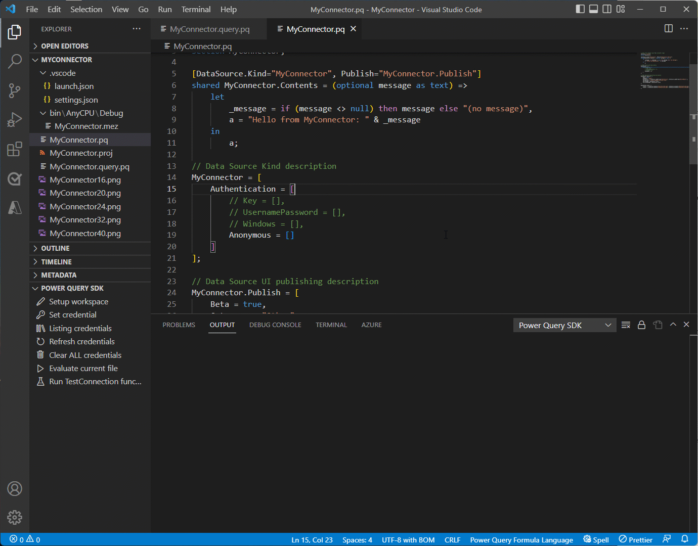

# Power Query Connector SDK for Visual Studio Code

> **_NOTE:_** The Power Query SDK extension for Visual Studio Code is currently in Public Preview. You can learn more about this extension and the development of Power Query data connectors from the link [aka.ms/PowerQuerySDKDocs](https://aka.ms/PowerQuerySDKDocs).

Provides functionality related to the development and testing of Custom Connectors for Power Query and Power BI.

Install the latest version of the [Power Query SDK through the Visual Studio Code Marketplace](https://aka.ms/PowerQuerySDK).



> **_NOTE:_** You can learn how to manually build and install this project from the article on [build and install](build.md).

## Features

What you can do with this extension:

- Create a new extension project using a custom connector template
- Build connector file (.mez)
- Set and manage credentials
- Run test queries
- Test your TestConnection function for refresh on the cloud
- View query results
- Leverage syntax highlighting and intellisense for writing M script
- Manage your workspace settings and other project-level configurations

## SDK Tools download and network troubleshooting

The extension downloads the `Microsoft.PowerQuery.SdkTools` NuGet package to provide tools such as `PQTest.exe`. By default, it queries and downloads directly from `https://api.nuget.org`. Organization policies, firewalls, authenticated proxies, DNS problems, or TLS certificate errors can prevent this, including during the initial package-version lookup.

When acquisition fails, the extension displays guidance with actions to **Configure NuGet**, open this troubleshooting section, or **Show Output** for diagnostics. An existing usable SDK Tools selection is reused on startup without downloading again.

### Use an organization-approved feed

1. Obtain `nuget.exe` through your organization's approved distribution process. Configure its proxy, feed authentication, credential provider, and trusted certificates as required by your organization.
2. Ask your feed administrator for a package source that contains `Microsoft.PowerQuery.SdkTools` and the version required by the extension's SDK Tools version settings. A reachable feed without this package or version is not sufficient.
3. Open VS Code Settings and search for `powerquery.sdk.externals.nuget`. Set **both** settings below, preferably in User settings for machine-specific paths. For example, in `settings.json`:

```json
{
    "powerquery.sdk.externals.nugetPath": "C:\\Tools\\NuGet",
    "powerquery.sdk.externals.nugetFeed": "https://packages.example.com/nuget/v3/index.json"
}
```

`nugetPath` must be the **folder containing `nuget.exe`**, not the path to the executable. Setting it switches package lookup and installation to the NuGet CLI. `nugetFeed` is passed to that CLI as `-Source`; **setting only `nugetFeed` does not redirect the default HTTP downloader**. If `nugetPath` is set but `nugetFeed` is empty, NuGet uses its configured package sources.

For a disconnected environment, use an approved local NuGet feed containing the required `.nupkg` package instead of a URL, for example `"powerquery.sdk.externals.nugetFeed": "C:\\NuGetFeed"`. The NuGet CLI is still required.

After saving the settings, run **Power query: Update PQ SDK Tools** from the Command Palette. Changing feed settings alone does not retry a failed download.

### Diagnose feed, proxy, and authentication issues

- Open **View > Output** and select **Power Query SDK** to inspect the underlying error. A blocked host, proxy authentication failure, inaccessible feed, missing executable, or missing package can require different remedies.
- Verify the executable exists in the configured folder. In PowerShell, test version discovery against the same feed without depending on nuget.org:

  ```powershell
  & 'C:\Tools\NuGet\nuget.exe' list Microsoft.PowerQuery.SdkTools -AllVersions -Source 'https://packages.example.com/nuget/v3/index.json'
  ```

- If listing works but downloading fails, verify installation into a writable scratch folder using `nuget.exe install Microsoft.PowerQuery.SdkTools -Version <required-version> -Source <your-feed> -OutputDirectory <scratch-folder>`. Use the version from the SDK Tools settings or Output diagnostics. The SDK installs packages into its own managed cache when you retry **Update PQ SDK Tools**.
- For HTTP 401/403 errors, check feed permissions and authentication with your administrator. For HTTP 407 errors, configure NuGet's proxy authentication. The NuGet CLI uses its own configuration and credential providers; do not assume VS Code proxy settings also configure `nuget.exe`. See Microsoft's [NuGet proxy configuration](https://learn.microsoft.com/nuget/reference/nuget-config-file#config-section) and [consuming packages from authenticated feeds](https://learn.microsoft.com/nuget/consume-packages/consuming-packages-authenticated-feeds).
- For connection timeouts, DNS failures, or TLS/certificate errors, verify VPN access, firewall rules, and organization-managed certificate trust. Do not disable TLS verification or bypass organization network controls.
- If NuGet cannot find a compatible package version, ensure the approved feed mirrors the required versions and review the extension's **SDK Tools version tag** and custom version settings.

Do not put passwords or tokens in feed URLs, shared workspace settings, or source control. Use your organization's approved credential flow, and remove sensitive information before sharing diagnostic output.

For extension development and local integration tests, `PQSDK_TEST_TOOLS_PATH` can select an already extracted SDK Tools directory, or `PQSDK_TEST_TOOLS_AUTODISCOVER=1` can find the latest stable SDK Tools in your NuGet global packages cache, without any SDK package requests. See [local testing without nuget.org](TESTING.md#local-testing-without-nugetorg) for the overrides and isolated internal-feed test configuration. These development/test-only overrides do not affect installed production extensions.

## Developer Guide

### Testing Architecture

This extension uses a modern, comprehensive testing approach designed for reliability and maintainability:

#### Test Types

- **Unit Tests**: Pure business logic testing with no external dependencies
    - Property-based testing for validation logic
    - Performance testing with automated thresholds
    - Edge case and boundary condition testing
    - Service logic testing with dependency injection

- **Integration Tests**: VS Code API integration testing
    - Extension loading and command registration
    - Schema management and validation
    - File system operations in VS Code context

#### Running Tests

```bash
# Run all tests (unit + integration)
npm test

# Run only unit tests (fast, no VS Code dependencies)
npm run test:unit-test

# Run only integration tests (requires VS Code)
npm run test:e2e
```

#### Test Development Patterns

The project follows these testing patterns:

1. **Pure Business Logic**: Extract validation and data processing into testable functions
2. **Service Abstraction**: Use dependency injection with interface abstractions
3. **Property-Based Testing**: Generate random test data to verify business rules
4. **Performance Baselines**: Automated performance testing with realistic thresholds

#### Adding New Tests

- Place unit tests in `unit-tests/` directory
- Use property-based testing for validation logic
- Include edge case and performance tests for critical paths
- Follow existing patterns in `unit-tests/validation/` and `unit-tests/commands/handlers/`

### Build and Development

```bash
# Install dependencies
npm install

# Development build (watch mode)
npm run watch

# Production build
npm run compile

# Lint code
npm run lint

# Package extension
npm run package
```

## Related projects

[vscode-powerquery](https://github.com/microsoft/vscode-powerquery)

## Contributing

This project welcomes contributions and suggestions. Most contributions require you to agree to a
Contributor License Agreement (CLA) declaring that you have the right to, and actually do, grant us
the rights to use your contribution. For details, visit <https://cla.opensource.microsoft.com>.

When you submit a pull request, a CLA bot will automatically determine whether you need to provide
a CLA and decorate the PR appropriately (e.g., status check, comment). Simply follow the instructions
provided by the bot. You will only need to do this once across all repos using our CLA.

This project has adopted the [Microsoft Open Source Code of Conduct](https://opensource.microsoft.com/codeofconduct/).
For more information see the [Code of Conduct FAQ](https://opensource.microsoft.com/codeofconduct/faq/) or
contact [opencode@microsoft.com](mailto:opencode@microsoft.com) with any additional questions or comments.

## Trademarks

This project may contain trademarks or logos for projects, products, or services. Authorized use of Microsoft
trademarks or logos is subject to and must follow
[Microsoft's Trademark & Brand Guidelines](https://www.microsoft.com/en-us/legal/intellectualproperty/trademarks/usage/general).
Use of Microsoft trademarks or logos in modified versions of this project must not cause confusion or imply Microsoft sponsorship.
Any use of third-party trademarks or logos are subject to those third-party's policies.

## Support and issues

Before creating a new issue or discussion, please make sure to the read our [support](SUPPORT.md) article for guidelines.
